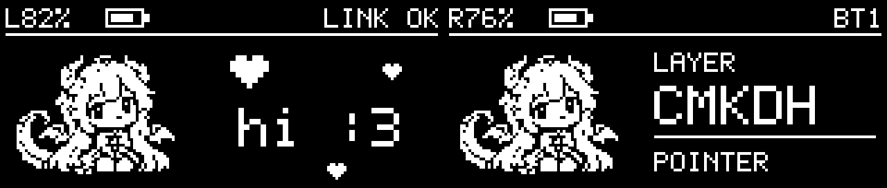

# zmk-config-velvet

Corne Colemak-DH mapping for Velvet, with a horizontal dragon-girl display on
each half and gentler trackball defaults for macOS.

## Controls

The three typing rows and six primary thumb keys follow
`zmk-new_corne/config/eyelash_corne.keymap`, including home-row modifiers,
hold-tap timings, and Escape/Tab/Backspace/Quote combos. Velvet keeps its extra
number row, three mouse buttons and volume encoder.

Bottom keys, from left to right on each half:

| Half | 1 | 2 | 3 | 4 | 5 |
| --- | --- | --- | --- | --- | --- |
| Left | Mute | Play/Pause | Delete; hold WM | Hold SYMNUM | Space |
| Right | Enter | Hold FN | Caps; hold to enter GAMING | Hold SCROLL | Hold PRECISION |

Layers are `CMKDH`, `GAMING`, `SYMNUM`, `FN`, `MOUSE`, `WM`, `SCROLL`, and
`PRECISION`. Holding SYMNUM and FN together activates MOUSE/numpad. In GAMING,
the FN and Caps thumb positions return to CMKDH. The four text combos retain
their original timing and operate in CMKDH/GAMING. The existing number-row
Escape + Backspace bootloader combo remains available.

Corne's RGB actions are inactive because Velvet has no configured RGB strip.
Its soft-off actions remain conditional on existing soft-off support, which is
not enabled here. No peripheral-power or backlight action replaces them. The
Corne repository and Velvet's board definitions, GPIO/SPI wiring, matrix,
sensor orientation/CPI/report interval, power, and BLE settings are unchanged.

## Trackball

| Mode | Setting |
| --- | --- |
| Normal | Runtime multiplier/divisor `3/4` (75% of the previous default) |
| Scroll | Runtime multiplier/divisor `1/80` (previous default `1/60`) |
| Precision | One-third of the current normal speed; `1/4` of raw motion with the new defaults |

Scroll and precision are momentary: release the key to return to normal.
Scrolling takes priority when both are held. Precision preserves runtime
rotation/inversion and never writes persistent settings. Scrolling keeps the
existing direction. WM no longer activates the trackball's scroll override.

Saved DYA Studio input-processor settings override these compiled defaults.
For an already configured keyboard, set the **mouse** processor scale to
multiplier `3`, divisor `4`, and the **scroll** processor to multiplier `1`,
divisor `80` in Studio. Leave the sensor at its existing 1600 CPI. See the
[runtime processor documentation](https://github.com/cormoran/zmk-module-runtime-input-processor).

Studio can also retain old keymap edits across flashes. Use Studio's keymap
restore/reset-to-firmware-defaults function if an old mapping remains; this is
separate from the `settings_reset` firmware, which also resets unrelated settings.

## Horizontal displays

Both screens use their native **160 × 68 landscape** orientation. The left
peripheral shows its battery, split-link status, hearts and the dragon girl;
the right central shows its battery, selected Bluetooth profile or USB,
current typing layer and POINTER/SCROLL/PRECISE mode. `?` after an output means
it is disconnected, `--%` means battery reporting is unavailable, and `+`
means USB power is present (not a measured charging indication).

The four monochrome frames blink, sway the tail and wave over a 4.8-second
cycle. Animation pauses when the existing idle policy takes effect; the
memory display may retain its last image. Layer changes remain visible while
holding pointer-mode keys. Artwork uses 1,664 bytes in flash, and the custom
packed framebuffer uses 1,360 static bytes. The renderer runs synchronously
on ZMK's display queue and retains the existing 8 KiB LVGL pool.

Actual firmware drawing code rendered on the host, enlarged 4×; status values
are examples:



[Native-size PNG](assets/display/preview-native.png) ·
[Status examples](assets/display/status-examples.png) ·
[Artwork sources and generation prompts](assets/display/README.md)

## Validation and builds

```sh
python3 scripts/check_keymap.py
python3 scripts/check_display.py
```

The first check compares all 252 mapped bindings, hold-taps and combos with the
sibling Corne repository. Use `--corne /path/to/eyelash_corne.keymap` for another
checkout. The second compiles the actual portable renderer with a host C11
compiler and AddressSanitizer/UndefinedBehaviorSanitizer, checking buffer bounds,
both roles, battery limits, long names, pointer precedence and animation frames.

`python3 scripts/check_display.py --preview` regenerates the displayed previews.
`python3 scripts/pack_dragon_art.py` re-encodes the source sheet into committed C
arrays. These two asset operations require ImageMagick 7; firmware builds do not.

Full Zephyr firmware compilation was not available in the implementation
environment: no west/ARM SDK, Docker daemon or dependency-download access.
Host validation is not a firmware build or an on-device test. The existing
Build ZMK firmware workflow still builds `velvet_left nice_view` and
`velvet_right nice_view`; run it to produce and verify both UF2s before flashing.
The display is included through this repository's Zephyr module, with no new
external dependency or shield changes.

## 改键客户端
https://github.com/cormoran/dya-studio/releases

## 网页改键
https://studio.dya.cormoran.works/



_(keymap image generated by [caksoylar/keymap-drawer](https://github.com/caksoylar/keymap-drawer))_

